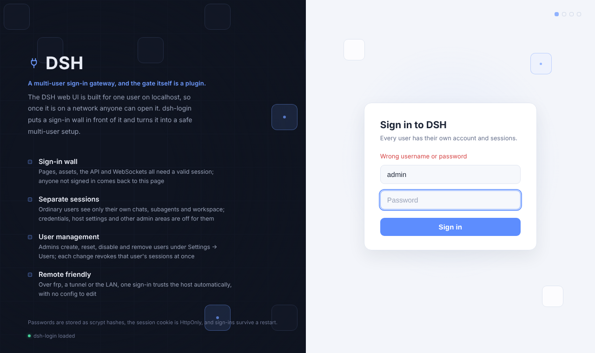
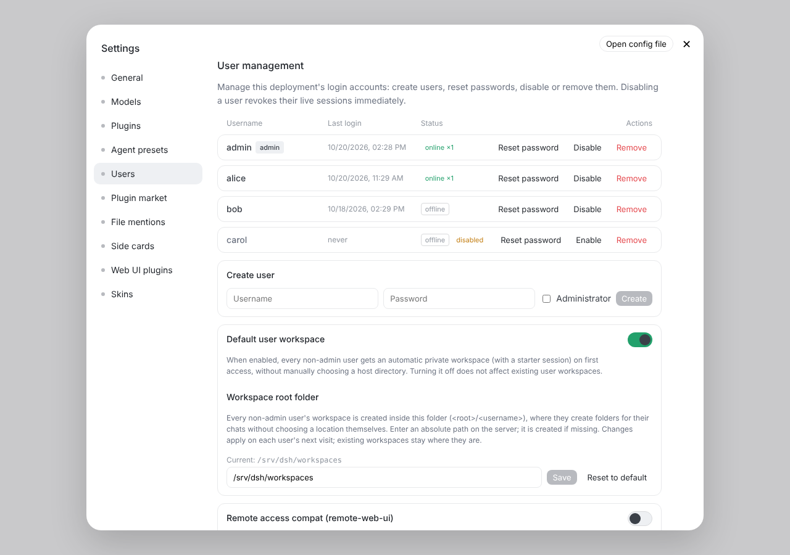

# dsh-login (English fork)

Sign-in and separate user accounts for the [DeepSeek Harness](https://github.com/deepseek-ai/deepseek-harness) (DSH) web UI.

This is a fork of [islibaodong/dsh-login](https://github.com/islibaodong/dsh-login) with the sign-in and setup pages in English. Everything else is upstream's code. The package keeps its upstream name, `@islibaodong/dsh-login`, so it replaces the upstream copy in place.

| Sign-in page | Settings → Users |
|:---:|:---:|
|  |  |

## Why

The DSH web UI has no login: it assumes one person on localhost. Once it is reachable on a network, anyone who can open it can read every conversation, use your model keys and change settings. dsh-login puts a sign-in wall in front of it and gives each person their own account.

## What you get

- **Sign-in wall:** pages, assets, the API and WebSockets all need a valid session. Visitors without one land on `/login`.
- **Accounts:** the first visit creates the administrator. The admin adds everyone else under Settings → Users.
- **Separate conversations:** ordinary users see only their own sessions, subagents and workspace. Credentials, plugins, presets and host settings are admin only.
- **A folder per user, chosen by the admin:** each ordinary user gets their own folder inside a root the admin picks, and can't create workspaces or sessions outside it. See [User folders](#user-folders).
- **User management:** admins see last sign-in and online status, and can reset passwords, disable or remove users. Each change signs that user out at once.
- **Sessions survive restarts:** the cookie is HttpOnly, SameSite=Strict and lasts 7 days. Passwords are stored as scrypt hashes.

## Install

```bash
dsh plugin --profile web add github:ViriatusOG/dsh-login
```

Restart `dsh web` and open it. The first visit asks you to create the administrator account. Then sign in and add users under **Settings → Users → Create user**.

`dist/` is committed and there is no build script, so the install from git runs nothing. To pin a version, add `#<commit>` to the address.

Remove it with:

```bash
dsh plugin --profile web remove @islibaodong/dsh-login
```

Removing the plugin keeps the accounts (they live in DSH's credential store), so adding it again brings them back.

## User folders

As admin, open **Settings → Users** and find **Default user workspace**:

1. Leave the switch on. Each ordinary user then gets a workspace the first time they open the app, with a starter chat in it.
2. Under **Workspace root folder**, enter an absolute path on the server (for example `/srv/dsh/workspaces`) and press **Save**. The folder is created if it doesn't exist.

Each user's workspace is `<root folder>/<username>`. Users create folders for their chats inside it and never pick a location themselves:

- Requests from ordinary users that name a folder outside their own (creating a workspace, or starting a chat in another folder) are refused. Admins are not restricted.
- Changing the root folder applies on each user's next visit: they get a new workspace in the new folder. Workspaces in the old folder stay where they are.
- **Reset to default** goes back to `<DSH_HOME>/workspaces`, or to the `workspaceRoot` value in the plugin config if you set one.

This controls where workspaces are created and which ones users see. It is not an OS-level sandbox: a user's agent and terminal still run as the server's account (see below).

## Good to know

- **Everyone runs on one machine account.** Accounts keep conversations apart, but every user's agent runs commands on the server as the user DSH runs as. Only give accounts to people you trust with that.
- **Use HTTPS on the internet.** Over plain HTTP the session cookie is sent in the clear. Put a reverse proxy with TLS (nginx, Caddy) in front for anything beyond a home LAN.
- **Tunnels and other hosts work.** A host you sign in through once (frp, a tunnel, a LAN address) is trusted from then on. The list is in Settings → Users → Allowed hosts.
- **Ordinary users can't pick host folders.** That's on purpose. Their workspace is created for them inside the admin's root folder.

## Where data lives

| What | Where |
|------|-------|
| Accounts (scrypt hashes) | DSH credentials, ref `DSH_LOGIN_PASSWORD_USERS` |
| Sign-in sessions | `<DSH_HOME>/.dsh-login/sessions.json` |
| Who owns which session | `<DSH_HOME>/.dsh-login/ownership.json` |
| Trusted hosts, settings (including the workspace root folder) | `<DSH_HOME>/.dsh-login/*.json` |
| User folders | `<root folder>/<username>`, default `<DSH_HOME>/workspaces/<username>` |

## Keeping up with upstream

Versions are upstream's plus `-en.N` (this one is `0.3.5-en.2`). For a new upstream release:

1. Merge upstream into `master`.
2. If `src/login-page.ts` changed, re-apply the English text.
3. Rebuild with `node scripts/build-host.mjs` (only `esbuild` is needed) and commit `dist/`.
4. Bump the version.

How it works inside (routes, the API wall, the permission model, compatibility notes per DSH version) is documented in detail in [upstream's README](https://github.com/islibaodong/dsh-login#readme) and in [`docs/`](docs/).

## License

MIT, as upstream. See [LICENSE](LICENSE).
